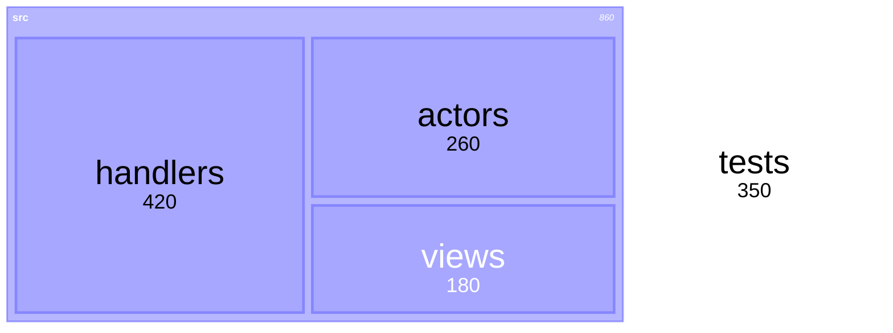

# Flows, hierarchies & networks

Genres where the *structure* is the message: who flows into whom, what
contains what, what connects to what. In the vendored set these split
between **Mermaid** (quick, text-authored, verified types) and **D3**
(full control, computed data). Vega-Lite covers the aggregated/statistical
variants.

## Which genre

| The ask mentions                       | Genre            | Default route          |
| -------------------------------------- | ---------------- | ---------------------- |
| Flow between stages, where traffic/money/tokens go | Sankey   | Mermaid `sankey-beta`  |
| Category-to-category change between two moments (vote shares, plan migrations) | Alluvial | Mermaid sankey, stage columns as periods |
| Circular bidirectional flows (trade between regions) | Chord | **No vendored renderer** — see gaps |
| Hierarchy with sizes (spend, disk, LOC) | Treemap          | Mermaid `treemap-beta` (small) / D3 (computed) |
| Hierarchy as rings / nested rectangles  | Sunburst / icicle | D3 `d3.hierarchy` + partition |
| Taxonomy, clustering results, phylogeny | Dendrogram       | D3 `cluster` (radial or linear) |
| Org chart / file tree                   | Tidy tree        | Mermaid flowchart / `treeView-beta` / D3 `tree` |
| Who-imports-whom, social graph, mesh    | Force-directed network | D3 `forceSimulation` |
| Two dimensions × intensity (activity, latency grid) | Heatmap | Vega-Lite `rect` + color |
| GitHub-style daily activity             | Calendar heatmap | D3 rect grid |
| Concentration (is it uniform?)          | Density plot / contour | Vega-Lite `density` transform; D3 `contourDensity` for 2D |

## Mermaid recipes (verified in this build)

### Sankey

```html
<script src="/vendor/mermaid/mermaid.min.js"></script>
<pre class="mermaid">
sankey-beta
Build,Review,50
Review,Merge,40
Review,Reopen,10
Merge,Deploy,35
Merge,Hotfix,5
</pre>
```

CSV rows: `source,target,value`. Column order follows first appearance —
arrange rows so stages read left to right. Good for: build pipelines,
budget flows, token spend by model→feature, user funnels with volumes.

### Treemap (small trees)



Nested indentation, leaf values are the sizes. Hand-authored treemaps
cap out around a dozen leaves; beyond that, compute one.

### Tidy tree / org chart

`flowchart TD` with `---` links (no arrowheads for containment); or
`treeView-beta` for a compact indented outline. For org charts, flowchart
with `subgraph` boxes per department renders cleanly.

## D3 recipes (computed data)

The vendored d3 core bundle includes the full `d3-hierarchy` module
(`hierarchy`, `tree`, `cluster`, `treemap`, `partition`, `pack`), plus
`forceSimulation`, `bin`, scales, zoom, and brush. No separate packages
are vendored (no d3-sankey, no d3-chord, no d3-cloud).

### Force-directed dependency/import graph

```html
<script src="/vendor/d3/d3.min.js"></script>
<div id="graph"></div>
<script>
const nodes = [
  { id: 'server.rs' }, { id: 'bus.rs' }, { id: 'store.rs' }, { id: 'cli.rs' },
];
const links = [
  { source: 'cli.rs', target: 'server.rs' },
  { source: 'server.rs', target: 'bus.rs' },
  { source: 'server.rs', target: 'store.rs' },
];
const width = 700, height = 420;
const svg = d3.select('#graph').append('svg')
  .attr('viewBox', [0, 0, width, height]);
const sim = d3.forceSimulation(nodes)
  .force('link', d3.forceLink(links).id(d => d.id).distance(90))
  .force('charge', d3.forceManyBody().strength(-300))
  .force('center', d3.forceCenter(width / 2, height / 2));
svg.selectAll('line').data(links).join('line')
  .attr('stroke', 'var(--fg)').attr('stroke-opacity', 0.4);
svg.selectAll('circle').data(nodes).join('circle')
  .attr('r', 8).attr('fill', 'var(--accent)')
  .call(d3.drag()
    .on('start', (e, d) => sim.alphaTarget(0.3).restart() && (d.fx = d.x, d.fy = d.y))
    .on('drag', (e, d) => (d.fx = e.x, d.fy = e.y))
    .on('end', (e, d) => sim.alphaTarget(0)));
sim.on('tick', () => {
  svg.selectAll('line')
    .attr('x1', d => d.source.x).attr('y1', d => d.source.y)
    .attr('x2', d => d.target.x).attr('y2', d => d.target.y);
  svg.selectAll('circle').attr('cx', d => d.x).attr('cy', d => d.y);
});
</script>
```

Give nodes computed attributes: `r` by fan-in/fan-out, color by module
cluster, red for cycles. Real data comes from your file tools — read
imports, build the edge list, inline it.

### Treemap from computed sizes

```js
const root = d3.hierarchy(treeData).sum(d => d.value);
d3.treemap().size([width, height]).paddingInner(2)(root);
// root.leaves() → rect per leaf; color by depth or by metric.
```

`treeData` is your computed tree (`{children: [...], value: n}`). Use
for LOC-by-directory, spend-by-category, coverage-by-file (color =
coverage rating, area = size — the SonarQube pattern).

### Sunburst / icicle / dendrogram

Same `d3.hierarchy` root; swap the layout:

- `d3.partition()` → ring segments (sunburst, with `d3.arc`) or stacked
  bars (icicle — generally the more *readable* of the two in studies).
- `d3.cluster()` → leaf-aligned dendrogram; for clustering results,
  radial form reads well. Mermaid flowcharts can fake a small dendrogram
  but can't place leaves at equal depth — use D3 past ~10 leaves.
- `d3.pack()` → circle packing; friendlier than treemap for showing
  topology through containment, less space-efficient.

### Heatmap & calendar heatmap

- Grid heatmap: Vega-Lite `{mark: 'rect', encoding: {x: {field, type:
  'ordinal'}, y: {field, type: 'ordinal'}, color: {field: value}}}` —
  three lines of spec, hard to beat.
- Calendar heatmap (daily activity): D3 rect grid, one column per week,
  one cell per day, color = count; add month labels and a legend ramp.

## Aggregated variants in Vega-Lite

- **Alluvial-style stage flows** — no native alluvial mark; approximate
  with a sankey (Mermaid) when stage-to-stage volumes matter, or stacked
  bars per stage with matching colors when only composition matters.
- **2D density** — `{mark: 'rect', transform: [{density: 'x'}, ...]}`
  for 1D; 2D contours need D3's `contourDensity` (present in bundle).
- **Binned heatmap** — `{mark: 'rect'}` with both axes `bin: true` and
  color = count: the latency-vs-frequency grid.

## Gaps (be upfront with the user)

- **Chord diagrams** — no vendored renderer (no d3-chord; Mermaid doesn't
  ship one). For circular bidirectional flow, a sankey or an adjacency
  matrix (heatmap with both axes = categories) carries the same data.
- **Alluvial with strict stage-parity semantics** — approximate, don't
  fake; say what the artifact actually shows.
- **Edge-bundled hierarchies, hive plots** — not vendored, rarely worth
  the effort a request for them implies.

## Antipatterns

- **Sankey with no meaningful volumes.** If edges don't carry quantities
  the widths encode nothing and the genre reads as decoration — use a
  flowchart instead. Cap around 30 nodes; past that it's spaghetti.
- **Sankey columns that aren't stages.** The genre implies left-to-right
  progression; a general network crammed into sankey form misleads.
- **Force layout for a tiny fixed graph.** Under ~15 nodes, a Mermaid
  flowchart with deterministic layout is more readable and stable;
  force layouts jitter, and nondeterministic positions hurt artifacts
  the user will screenshot or revisit.
- **Force layout with default settings for real graphs.** Without
  distance/charge tuning and collision forces, labels overlap into
  noise; tune per dataset, or cluster-color first and skip force for
  the giant component.
- **Treemap for hierarchy *shape*.** Treemaps encode size; the nesting
  is secondary. When the ask is "show the tree", a tidy tree/dendrogram
  is the honest genre — treemap when the ask is "show where the mass is".
- **Sunburst by default.** Ring segments are the hardest partition form
  to read (studies favor icicle/treemap for comparison tasks); choose
  sunburst when the radial form itself helps (arc length at a shared
  radius) or the user asked for it.
- **Heatmap without a color legend.** A grid of colors with no ramp
  legend is unreadable; label the ramp's min/max, and pick a sequential
  scheme (not categorical hues) for continuous values.
- **Calendar heatmaps with unaligned weeks.** Anchor columns on real
  week boundaries (Sun/Mon per the user's locale) or the weekday stripes
  lie.
- **Recomputing the hierarchy on every render.** `d3.hierarchy().sum()`
  mutates; compute once, keep the layout result, and re-render from the
  stored layout on interaction — live-reload edits otherwise reset user
  state constantly.
- **Inlining a 50k-edge graph into the artifact.** The file and the
  browser both choke. Aggregate first (cluster to modules, top-N edges
  by weight), and put the full edge list in a sibling JSON the page
  fetches.
